# pptx-toolkit

**내용과 논리를 적은 JSON 명세에서, 고객이 다음 날 직접 고칠 수 있는 전문가 수준의 PPTX를 만들고 검증하는 도구 모음이자 Claude 스킬입니다.**
정부·공공기관 보고, 컨설팅 그레이드 임원 보고, 한국형 제안서·영업자료, 공공 RFP 제안서, 에디토리얼 백서, 고밀도 리포트, IR 피치, 키노트를 위한 스타일 프로파일 10종과 아키타입 29종을 내장했습니다.

> Build editable, professional-grade PowerPoint decks from a `deck-spec.json` — Korean government briefings, consulting-style executive decks, proposals, editorial reports, IR pitches and keynotes — with automated quality gates (lint · package · geometry · pixel-bleed · number audit · text-loss · variety), font-metric overflow estimation, OKLCH palette derivation, a direction-comparison gate and render-based visual review. Python stdlib + PptxGenJS. MIT.

| 컨설팅형 (임원 보고, hybrid) | 정부형 (추진계획 보고, pre-read) | 제안형 (영업 제안, live) |
|---|---|---|
| 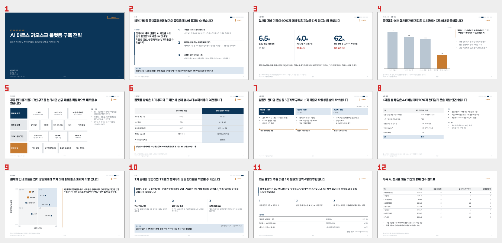 | 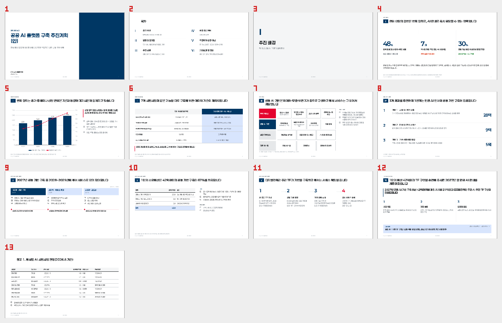 | 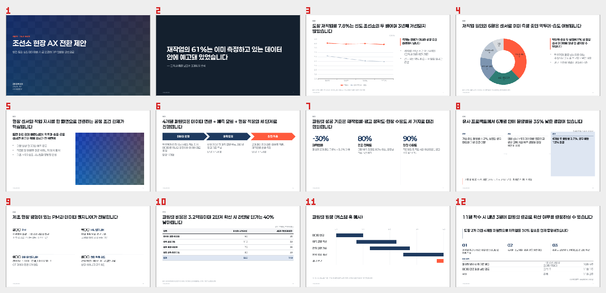 |

<p align="center">
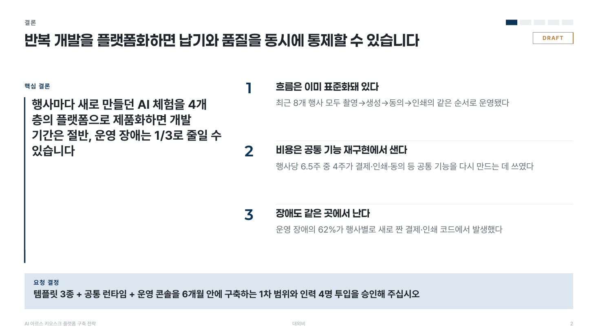 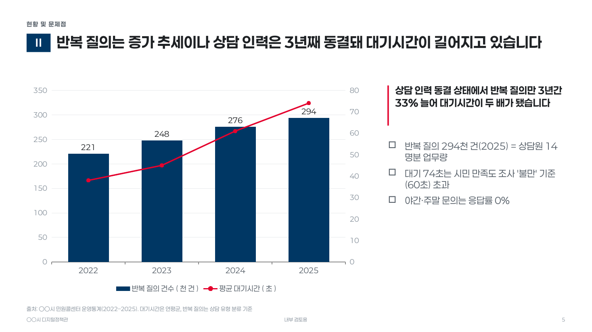
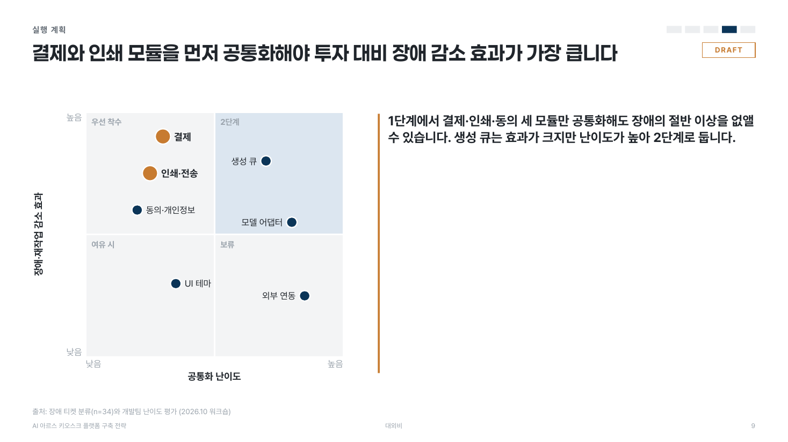 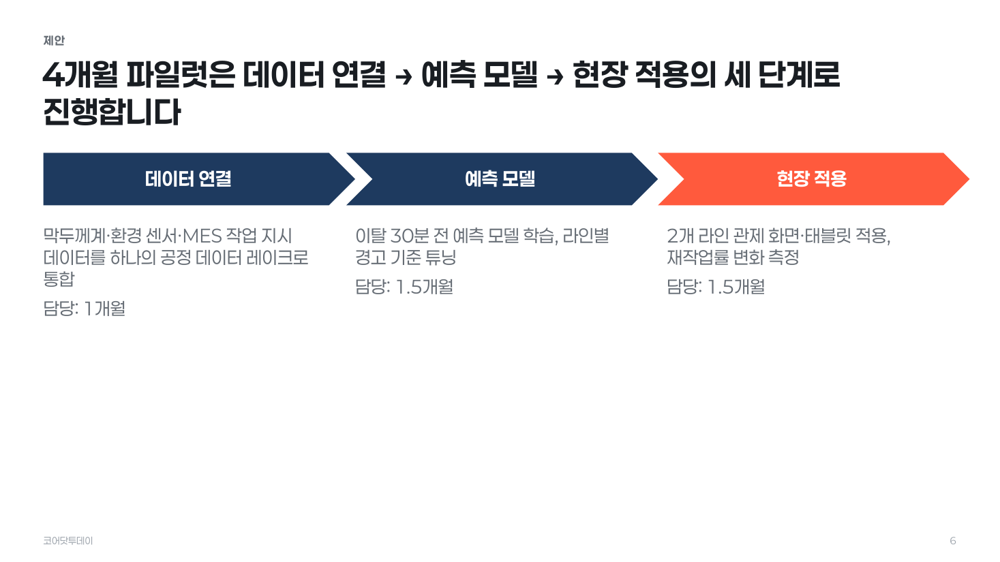
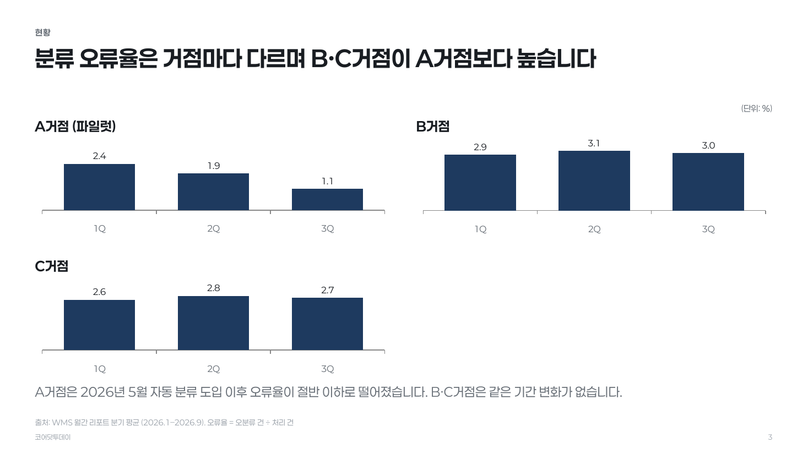 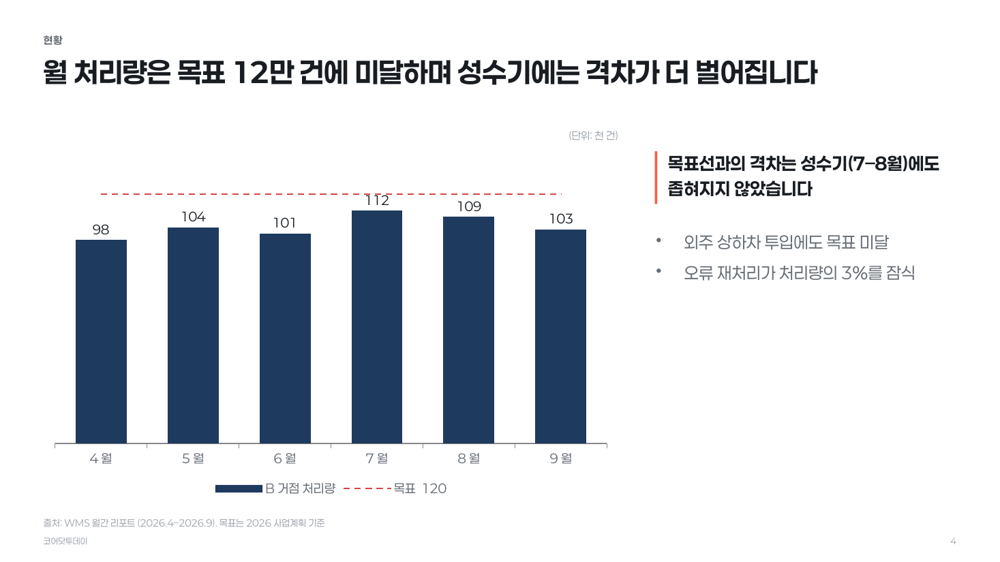
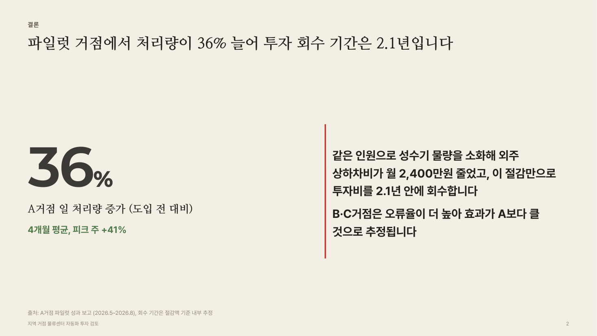 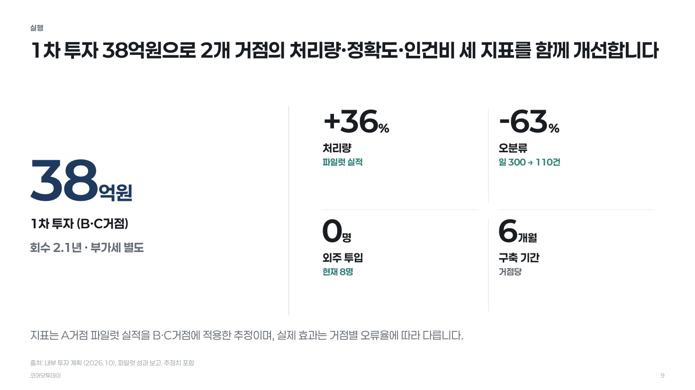

공공 RFP 제안서 프로파일(`proposal_rfp_kr`): 모든 장에 요구사항→대응방안→검증 기준→산출물 블록과 요구 ID 태그가 고정됩니다.

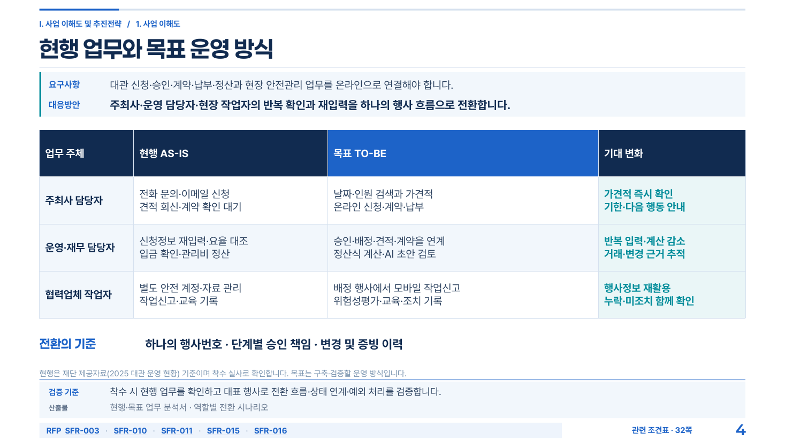 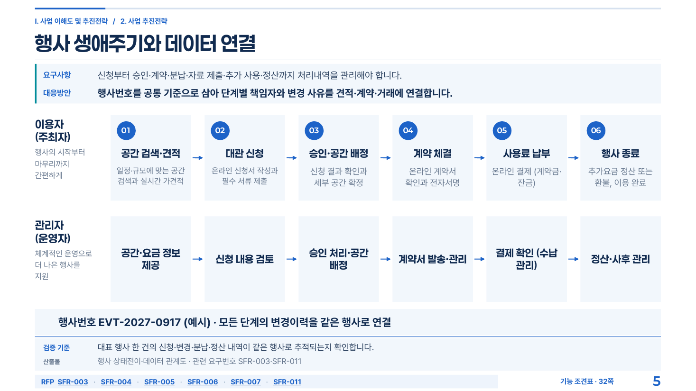
</p>

같은 명세를 프로파일 세 개로 만든 **방향 비교 시트**(`directions`): 왼쪽부터 제안형 · 두 글꼴 컨설팅형 · 에디토리얼형.

<p align="center">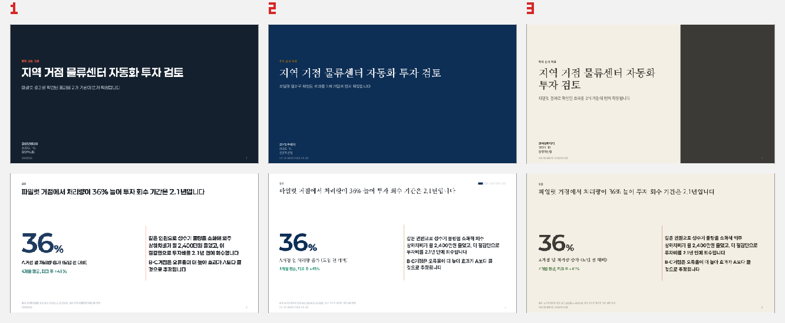</p>

위 이미지는 모두 `examples/`의 명세에서 자동 생성한 PPTX를 렌더한 것입니다. 수정 없이 나온 결과물입니다.

---

## 왜 만들었나

AI가 만든 PPT는 두 가지 이유로 실무에 못 씁니다. **편집이 안 되거나**(이미지 슬라이드, 깨진 차트), **예쁜데 틀립니다**(출처 없는 숫자, 합계 불일치, 토픽만 적힌 제목, 장표마다 다른 스타일). pptx-toolkit은 이 둘을 구조로 막습니다.

- **네이티브 PPTX** — 텍스트·표·차트가 PowerPoint 객체입니다. 차트 데이터를 PowerPoint에서 바로 고칠 수 있습니다.
- **내용과 디자인의 분리** — 사람(또는 Claude)은 `deck-spec.json`에 *무엇을 말할지*만 씁니다. 색·글꼴·여백·글자 크기·행간은 **스타일 프로파일 토큰**이, 슬라이드 구성은 **29개 아키타입**(요약·핵심 숫자·근거 차트·작은 차트 격자·비교·전후·프로세스·로드맵·아키텍처·2×2·중첩 시장·사례·권고·결론…)이 결정합니다. 같은 명세를 프로파일만 바꿔 정부형·컨설팅형·에디토리얼형으로 다시 만들 수 있고, `directions`가 그 비교 시트를 한 장으로 만들어 줍니다.
- **일곱 겹의 자동 게이트** — 명세 lint(액션 타이틀·글자량·출처·색 대비·AI 티) → 패키지 검사(PowerPoint가 거부하는 패턴) → 기하 검사(경계 이탈·겹침·**설치 폰트의 실제 글자 폭과 어절 단위 줄바꿈으로 추정한 넘침**·글자 하한·바닥 안전구역·이미지 해상도) → 렌더 픽셀 넘침 검출 → 내용 감사(합계·단위 혼용·기간·추정 표기) → 텍스트 손실 검증(명세의 모든 문자열·차트 데이터가 파일에 들어갔는지) → 변주 감사(레이아웃 반복·색 튐). 하나라도 실패하면 종료 코드가 0이 아닙니다. 렌더 전에는 한글이 실제로 그려지는 환경인지 프로브로 확인합니다.
- **한국 실무 규범 내장** — 정부상징 색상·보호공간·상징체 사용 제한, KRDS 60-30-10과 명도 대비 기준, 행정업무운영 편람의 항목 기호(□ ○ -, Ⅰ·Ⅱ 장 번호), 컨설팅 장표 문법(액션 타이틀·Exhibit·출처 줄·트래커), 숫자 중심 타이포그래피, CJK 행간·자간·기울임 금지 규칙. 모두 Paperlogy·Pretendard·Nanum Myeongjo(SIL OFL) 폰트 체계 위에서 동작합니다.
- **색은 도출한다** — 브랜드 hex나 로고 PNG에서 OKLCH로 주조·보조·강조와 중성 명도 램프를 수렴시키고(`palette`), 채도 밴드·색상 간격·대비를 검사한 뒤 한 문장 근거와 함께 토큰을 내놓습니다.
- **기존 PPTX·기관 양식** — 양식 분석(안전영역·글꼴·색 계약 추출), 슬라이드 복제·삭제·재배열, 텍스트 교체(넘침이 악화되면 저장을 거부), 텍스트 추출, 그리고 생성한 덱을 기관 양식 패키지에 이식해 마스터·로고·푸터를 물려받는 `inherit`.

---

## 빠른 시작

```bash
git clone https://github.com/koorukuroo/pptx-toolkit.git && cd pptx-toolkit
npm install                                   # PptxGenJS 하나만 설치됩니다
python3 scripts/pptx.py profiles              # 동작 확인 (Python 3.9+, 표준 라이브러리만)
```

```bash
# 1) 명세 스캐폴드 → 내용 작성 → 검사 (--ghost: 제목만 모아 읽는 '고스트덱')
python3 scripts/pptx.py new-spec -o deck-spec.json --profile consulting_grade --mode hybrid --title "플랫폼 구축 전략"
python3 scripts/pptx.py lint deck-spec.json --ghost

# 2) 방향 확정 — 프로파일 2~3개 × 표지·요약·데이터 장을 한 장의 비교 시트로
python3 scripts/pptx.py directions deck-spec.json -o build/directions         # build/directions/directions.png
python3 scripts/pptx.py directions deck-spec.json --approve two_font_consulting --note "제목이 더 권위 있어 보임" -o build/directions --apply-to-spec

# 3) 생성 — lint → PptxGenJS → 패키지 검사 → 기하 검사가 한 번에 실행됩니다
python3 scripts/pptx.py build deck-spec.json -o out.pptx

# 4) 검수 — 자동 게이트 묶음(텍스트 손실 검증 포함) + 렌더 이미지 + 변주 감사
python3 scripts/pptx.py qa out.pptx --spec deck-spec.json --bleed -o qa-report.json
python3 scripts/pptx.py render out.pptx                            # out.render/contact.png, slide-NN.png (한글 글꼴 프로브 포함)
python3 scripts/pptx.py variety out.render/out.pdf --spec deck-spec.json
```

예제 네 종을 바로 만들어 보려면:

```bash
npm run build:examples        # build/consulting.pptx, build/gov.pptx, build/proposal.pptx, build/showcase.pptx
npm test                      # 회귀 테스트 (빌드·게이트·추정기·팔레트·편집·상속·렌더)
```

### 선택 의존성

| 용도 | 필요 | 비고 |
|---|---|---|
| `render`, `bleed` (PDF → PNG) | LibreOffice + poppler(`pdftoppm`) | macOS는 `/Applications/LibreOffice.app` 자동 탐지, 다른 경로는 `SOFFICE=` 환경변수. `brew install poppler` |
| 실제 PowerPoint 렌더 | Microsoft PowerPoint (macOS) | `render --engine powerpoint` |
| 한글 글꼴 | Paperlogy, Pretendard, Noto Sans KR 중 하나 이상 (명조 프로파일은 Nanum Myeongjo) | `brew install --cask font-paperlogy`. 없으면 대체 글꼴로 생성하고 경고. 설치 폰트의 폭·행간은 넘침 추정에 그대로 쓰입니다 |

macOS 헤드리스 LibreOffice가 시스템 글꼴을 찾지 못해 한글이 빈 칸으로 렌더되는 문제는 도구가 전용 프로필(`~/.cache/pptx-toolkit/lo-profile`)에 글꼴 디렉터리를 연결해 자동으로 우회합니다.

### Claude 스킬로 쓰기

```bash
ln -s "$(pwd)" ~/.claude/skills/pptx-toolkit
```

`SKILL.md`가 진입점입니다. Claude는 브리프 → 근거표 → 명세(서사 역할·청중 상태) → 방향 비교 시트로 확정 → 전체 생성 → 게이트 → 렌더 검수 → 변주 감사 순서로 작업하며, 게이트를 통과하고 렌더 이미지를 직접 본 뒤에만 완료를 보고하도록 규칙이 정해져 있습니다.

---

## 어떻게 동작하나

```
브리프 → 근거표 → deck-spec.json ──lint──▶ directions (프로파일 비교 시트) ──승인──▶ build.js (PptxGenJS) ──check · inspect──▶ out.pptx
          palette ─▶ design_tokens         프로파일 토큰 × 아키타입 × 폰트 메트릭                                              │
                                                                       qa (bleed · audit --spec) → render (글꼴 프로브) → PNG 검수 → variety → 명세 수정 → 재빌드
기관 양식 ──template──▶ template-contract.json ─┬─ 파생 토큰으로 새 덱 (derived)
                                              ├─ slides → inventory → replace → qa   (양식 직접 채우기)
                                              └─ build → inherit → qa               (양식 틀에 생성 덱 이식)
```

### deck-spec.json

```json
{
  "metadata": { "title": "AI 아르스 키오스크 플랫폼 구축 전략", "audience": "대표이사 및 제품개발팀장",
                "success_condition": "1차 개발 범위와 6개월 일정을 승인한다", "delivery_mode": "hybrid" },
  "route": { "deck_type": "consulting_executive", "style_profile": "consulting_grade", "brand_mode": "neutral" },
  "evidence": [ { "id": "E2", "claim": "행사당 평균 개발 기간은 6.5주", "kind": "estimate", "confidence": "medium",
                  "source": "프로젝트 타임시트 집계 (8건)", "period": "2025.9–2026.9" } ],
  "slides": [
    { "number": 4, "section": "현황 진단", "archetype": "evidence_chart", "exhibit": 1,
      "title": "플랫폼화 이후 행사당 개발 기간은 6.5주에서 3주 이내로 줄어듭니다",
      "content": { "chart": { "type": "column", "categories": ["2025 하반기", "2026 상반기", "현재", "목표"],
                              "series": [ { "name": "개발 기간(주)", "values": [7.5, 6.5, 6.0, 2.8] } ], "highlight": 3 },
                   "insight": "템플릿으로 시작하면 행사별 작업은 브랜드 교체·문구 조정만 남습니다",
                   "callouts": ["공통 런타임이 결제·인쇄·동의를 흡수", "운영 콘솔에서 문구·브랜딩 교체"] },
      "source_note": "출처: 내부 타임시트 (실적), 목표치는 내부 추정", "evidence_ids": ["E2"] }
  ]
}
```

전체 필드는 `references/deck-spec-guide.md`, 아키타입별 `content` 계약은 `python3 scripts/pptx.py archetypes`로 확인합니다.

### 스타일 프로파일

| 프로파일 | 용도 | 특징 |
|---|---|---|
| `government_kr` | 부처·지자체·의회 보고, 공공기관 제안 | 정부청색 주조, 빨강은 경고에만, 로마 숫자 장 번호 칩, □ ○ - 기호, 흰 배경·넓은 여백 |
| `public_policy` | 연구·정책 보고서, 사전 배포 자료 | 읽기용 밀도, 완결 문장 제목, 출처 철저 |
| `consulting_grade` | 임원·이사회·전략·사업계획 | 액션 타이틀, 전시물 하나·결론 하나, Exhibit 번호, 섹션 트래커, DRAFT 스티커 |
| `two_font_consulting` | 자문·법률·금융 임원 보고 | consulting_grade 구조에 명조 제목 |
| `paperlogy_business` | 제안서·영업·내부 보고·교육 | 큰 숫자, 간결한 카피, 과감한 이미지 크롭, 이미지·어두운 표지 |
| `institutional_pitch` | IR·지원사업 심사·신사업 심의 | 남색 + 절제된 금속색 강조, 중첩 시장·2×2·큰 숫자, 과장 표현 lint |
| `proposal_rfp_kr` | 나라장터·공공 시스템 구축 제안서, 정성평가 | 모든 장에 요구사항→대응방안→검증 기준→산출물 블록, 요구 ID 태그 띠, 빵부스러기 킥커, 남색 표 머리글, 큰 쪽번호. 화면 증명(`screen_walkthrough`)·주체별 흐름(`swimlane`) |
| `editorial_report` | 연차보고·백서·문화기관 | 종이색 바탕, 명조 제목, 주사(朱砂) 강조 한 번, 넓은 행간 |
| `research_dense` | 조사·분석 리포트(pre_read) | 고밀도, 하한 11pt, 단색 명도 계단, Exhibit·트래커 |
| `executive_keynote` | 키노트·비전·제품 공개 | 어두운 배경, 장당 메시지 하나, 큰 글자 |

토큰(색·글꼴·글자 크기·행간·자간·여백·차트 팔레트·푸터·목록 기호·기본 배경)은 `references/style-profiles.json`에 있고, 명세의 `design_tokens`로 일부만 덮어쓸 수 있습니다. 각 프로파일의 `meta`(mood·occasion·formality·density)로 `profiles --match "occasion=투자"`처럼 고를 수 있습니다. 전달 모드(`live` / `pre_read` / `hybrid`)에 따라 글자 크기·행간과 허용 글자량이 달라집니다. 브랜드 색이 있으면 `palette 0F4C81 E4572E` 또는 `palette --image logo.png`가 토큰을 만들어 줍니다.

### 품질 게이트

| 게이트 | 커맨드 | 잡는 것 |
|---|---|---|
| 명세 | `lint` | 토픽 라벨 제목("현황", "전략"), 2줄 초과 제목, 글자량 초과, 출처 누락, 같은 레이아웃 3연속, "감사합니다" 마무리, 토큰 색 대비 < 4.5:1, 이모지·수동 글머리·근거 없는 과장·강조 남발·한글 기울임, 서사 역할 누락 |
| 패키지 | `check` | XML 손상, 관계·콘텐츠 타입 누락, 차트 축 미선언(차트가 통째로 사라지는 원인), 8자리 색상값, 자리표시 문구 잔재 |
| 기하 | `inspect` | 슬라이드 밖 요소, 텍스트 겹침, **설치 폰트의 실제 글자 폭·행간과 어절 단위 줄바꿈**으로 추정한 넘침, 본문 글자 하한, 바닥 안전구역, 한글 기울임, 이미지 110 DPI 미만·비율 왜곡 |
| 픽셀 | `bleed` | 슬라이드를 사방으로 키우고 회색 띠를 깐 뒤 렌더 → 띠가 오염되면 실제로 그려진 넘침 |
| 내용 | `audit [--spec]` | 표 합계 ≠ 행 합(오류), 억원·백만원 혼용, 부가세 표기 없음, 기간 없는 통계, 추정 표기 없는 미래 연도 수치; `--spec`이면 명세의 문자열·차트 범주·값이 파일에 모두 들어갔는지 |
| 렌더 환경 | `probe` (render가 자동 실행) | 이 LibreOffice/PowerPoint에서 한글이 실제로 그려지는 글꼴인지 — 아니면 렌더 판단을 보류 |
| 변주 | `variety` | 인접 슬라이드 레이아웃 반복, 한 장만 튀는 색, 8장 이상인데 배경 변화 없음, 이전에 납품한 덱과 똑같은 구성 |

`qa`가 이들을 묶어 `qa-report.json`을 만듭니다. 그 뒤 `render`한 PNG를 사람이(또는 Claude가) `references/quality-rubric.md`의 100점 루브릭으로 채점합니다. 결함은 생성된 파일을 손으로 고치지 않고 **명세를 고쳐 다시 빌드**합니다.

### 기존 PPTX와 기관 양식

```bash
python3 scripts/pptx.py template 양식.pptx -o template-contract.json   # 크기·글꼴·색·레이아웃·자리표시자·안전영역
python3 scripts/pptx.py slides 양식.pptx 작업.pptx --keep 1,3,3,5       # 1-based 새 순서 (중복=복제, 누락=삭제)
python3 scripts/pptx.py inventory 작업.pptx                             # 슬라이드별 텍스트 도형 id·박스·글자 크기·수용량
python3 scripts/pptx.py replace 작업.pptx 결과.pptx --map map.json      # 서식 유지 교체; 넘침 악화 시 .rejected.pptx
python3 scripts/pptx.py inherit out.pptx 양식.pptx -o 결과.pptx --layout "제목만" --cover-layout "표지"   # 생성 덱을 양식 틀에 이식
```

기관이 승인한 양식은 이 도구의 디자인 선호보다 우선합니다. 양식을 직접 채울 때는 마스터·푸터·로고를 건드리지 않고 내용만 채우고, 생성한 덱을 양식에 이식할 때는 양식의 마스터·레이아웃(로고·배경·푸터 그래픽·쪽번호 위치)을 물려받고 차트·이미지·노트를 함께 옮깁니다. 절차는 `references/template-workflow.md`.

---

## 커맨드 요약

| 커맨드 | 역할 |
|---|---|
| `profiles [--match]` · `archetypes` | 프로파일 10종(meta 라우팅), 아키타입 29종과 `content` 계약 |
| `new-spec` | 명세 스캐폴드 |
| `lint spec [--ghost]` | 명세 검사(AI 티 포함), 고스트덱 출력 |
| `palette hex… \| --image png [--check spec]` | OKLCH 팔레트 도출·검사 → `design_tokens` 조각 |
| `directions spec [--profiles a,b,c] [--approve b --note …]` | 방향 비교 시트와 승인 기록 |
| `build spec -o out.pptx [--only 1-3] [--hooks hooks.js]` | 생성 + check + inspect |
| `check` · `inspect` · `bleed` · `audit [--spec]` · `qa` · `variety` | 게이트 (위 표) |
| `render pptx [--engine libreoffice\|powerpoint]` · `probe` | 글꼴 프로브 → PDF → `slide-NN.png` + `contact.png` |
| `extract pptx [--format json]` | 제목·본문·표·차트·노트 추출 |
| `template` · `inventory` · `replace` · `slides` · `inherit` | 양식 분석, 기존 덱 편집, 양식 상속 |
| `fonts [family …]` · `fontmetrics [family …]` | 설치 글꼴 확인과 대체 제안, 실제 글자 폭·행간 |
| `unpack` · `pack` | OOXML 직접 편집 (`pack`은 check 자동) |

모든 커맨드는 JSON을 출력하고 실패 시 0이 아닌 종료 코드를 돌려줍니다. 편집 커맨드는 원본을 바꾸지 않고 새 파일을 만들며, 검사를 통과했을 때만 결과 파일명을 돌려줍니다.

### 커스텀 슬라이드

아키타입으로 표현되지 않는 장표는 `archetype: "custom"`으로 두고 `--hooks hooks.js`에서 PptxGenJS API로 직접 그립니다. 훅은 토큰(`ctx.pal`, `ctx.scale`, `ctx.font`)과 공용 프리미티브를 그대로 쓰므로 덱의 일관성이 유지됩니다. 예: `examples/proposal-hooks.js`(간트 차트).

---

## 저장소 구조

```
SKILL.md                      Claude 스킬 진입점 — 라우팅 · 제작 단계 · 필수 규칙
scripts/pptx.py               CLI (Python 3.9+ 표준 라이브러리)
scripts/build.js, scripts/lib 명세 → PPTX 렌더러 (tokens · fontmetrics · text · frame · primitives · charts · archetypes · theme)
core/                         package · check · inspect · fontmetrics · probe · bleed · render · variety · extract · edit · template · inherit · audit · lint · palette · directions · specio · fonts
references/                   style-profiles.json · slide-archetypes.json · 규칙 문서
  storyline-rules.md          전달 모드, 피라미드 구조, 액션 타이틀, 고스트덱
  government-rules.md         정부상징 · KRDS · 행정업무운영 편람 · 관행 목차
  consulting-rules.md         장표 문법 · 밀도 · 전시물 규칙
  paperlogy-rules.md          숫자 · 기준선 · 덩어리 · 트리밍 원칙의 토큰화
  typography-cjk.md           한글 글자 폭 · 어절 줄바꿈 · 행간 · 자간 · 기울임 금지 · 하한 환산표
  data-visualization.md       relation 기반 차트 선택 · 목표선 · 작은 차트 격자 · 정직성 · 표 규칙
  anti-patterns.md            "AI가 만든 PPT" 티를 막는 목록
  quality-rubric.md           100점 루브릭과 시각 검수 절차
  template-workflow.md        기관 양식 채우기 · 파생
  deck-spec-guide.md          명세 작성 안내
  pptxgenjs-notes.md          직접 검증한 생성 라이브러리 주의 사항
schemas/deck-spec.schema.json
examples/                     골든 샘플 4종 (+ 커스텀 훅)
docs/samples/                 예제 렌더 이미지
tests/                        python3 -m unittest discover -s tests
```

## 제약과 알아둘 점

- 렌더 검수는 LibreOffice 기준이라 줄바꿈·자간이 PowerPoint와 조금 다를 수 있습니다(제목이 조금 더 넓게 보임). 최종 확인은 PowerPoint에서 하거나 macOS에서 `--engine powerpoint`를 쓰세요. `render`는 먼저 글꼴 프로브로 이 환경에서 한글이 그려지는지 확인하고, 아니면 결과에 경고를 붙입니다.
- 넘침 추정은 설치 폰트의 실제 폭·행간을 쓰지만 커닝·합자·한글 금칙 처리는 반영하지 않습니다. 오차는 보통 ±5% 안이며, 폰트가 없으면 평균 계수로 떨어집니다.
- `replace`는 텍스트 도형만 다룹니다. 표 셀·차트 데이터는 `unpack`으로 XML을 직접 고친 뒤 `pack`하세요.
- 폰트 파일은 동봉하지 않습니다. 수신 PC에 Paperlogy가 없으면 대체 글꼴로 표시됩니다.
- 정부상징·기관 로고는 사용자가 제공한 승인 파일만 사용하며, 도구가 그리거나 흉내 내지 않습니다. 예제의 기관명·수치는 모두 가상입니다.

## 기여

이슈와 PR을 환영합니다. 새 아키타입은 `references/slide-archetypes.json`(계약)과 `scripts/lib/archetypes.js`(렌더러)를 함께 추가하고, 예제 명세 중 하나에 넣어 `npm test`가 통과하는지 확인해 주세요. 새 프로파일은 `references/style-profiles.md`의 절차를 따릅니다.

## 라이선스

MIT. 의존성 고지는 `THIRD_PARTY_NOTICES.md`.
